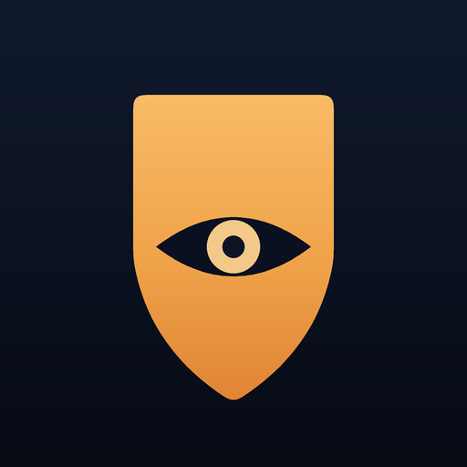
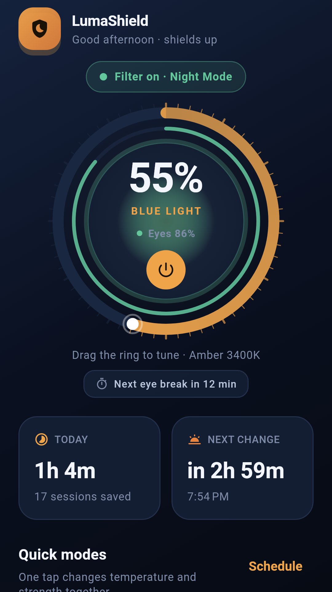
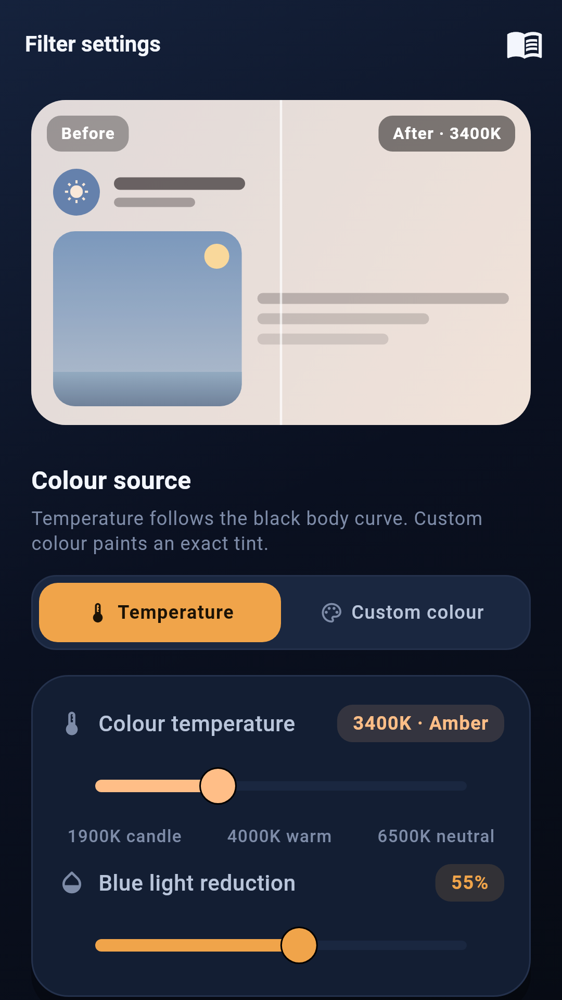
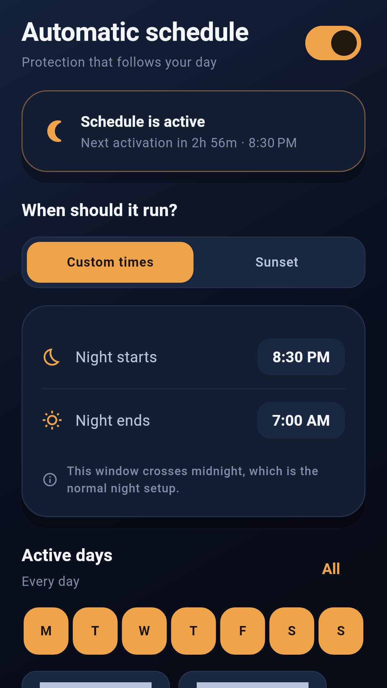
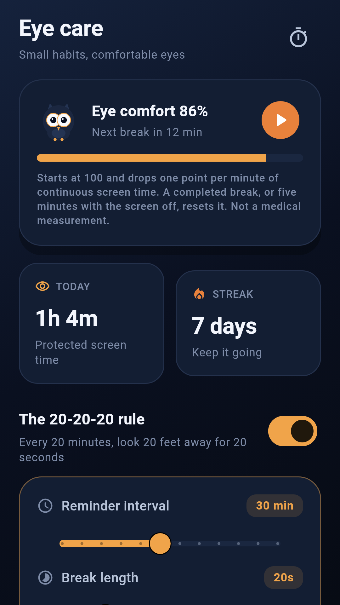
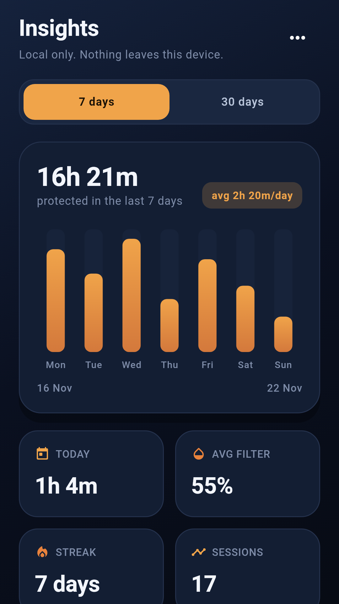
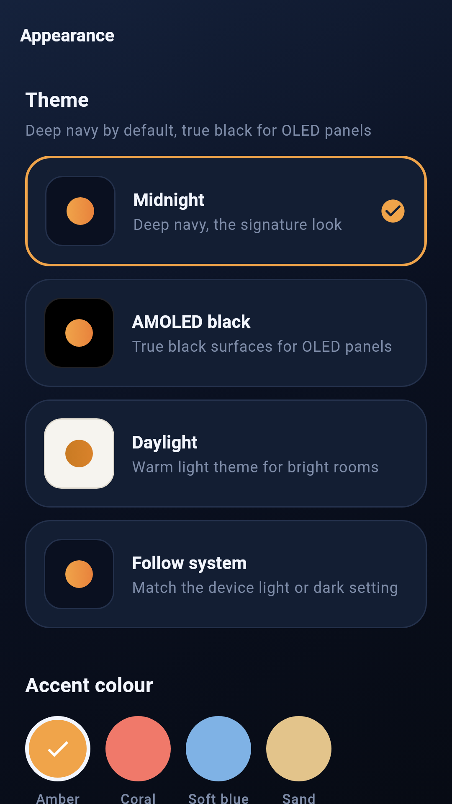
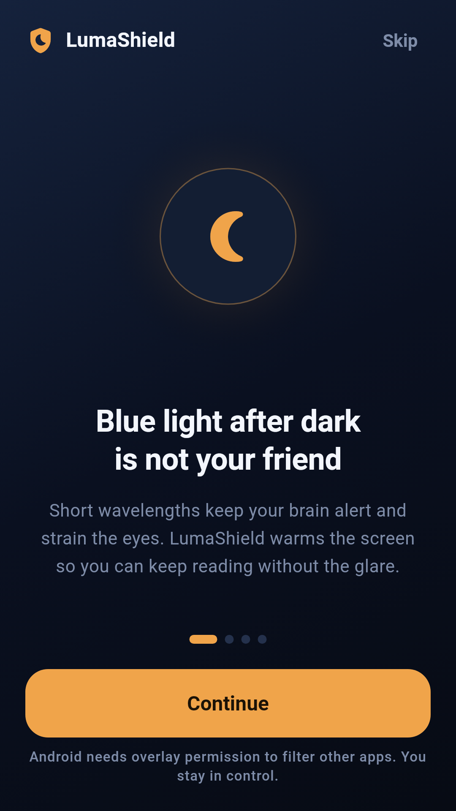
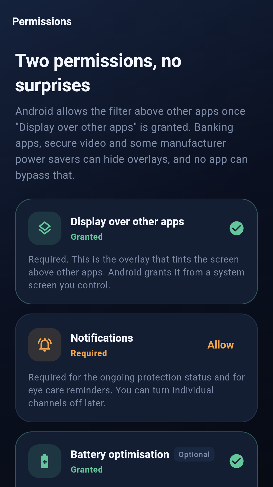
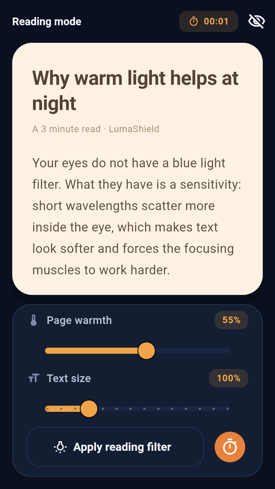

# LumaShield

**Blue light filter and eye care for Android, with an honest iOS story.**

LumaShield warms the screen to cut blue light, schedules the filter from sunset to
sunrise, and reminds you to rest your eyes. Everything runs on the device: no
account, no cloud, no analytics, no screen capture.

<p align="center">
  
</p>

---

## Screens

Rendered from the real widget tree with `tool/screenshots/screens_test.dart`
(1080x1920, same assets that go to the store listing).

| Dashboard | Filter settings | Schedule |
| --- | --- | --- |
|  |  |  |

| Eye care | Insights | Appearance |
| --- | --- | --- |
|  |  |  |

| Onboarding | Permissions | Reading mode |
| --- | --- | --- |
|  |  |  |

---

## Why the name

"BlueGuard" describes a single feature. **LumaShield** covers the whole product:
*luma* is light, a *shield* protects, and the name reads the same in every market.
Package id: `com.lumashield.app`.

---

## What actually works, per platform

The app never fakes a capability. The UI, the dashboard orb and the service card
all read live state from the native layer.

| Feature | Android | iOS |
| --- | --- | --- |
| System wide blue light overlay above other apps | Yes, with `SYSTEM_ALERT_WINDOW` | **No** - Apple does not allow it |
| Adjustable reduction 0-100%, 1900K-6500K | Yes | In-app tint only |
| Warm / amber / orange / warm-red and custom colour | Yes | Yes (in-app) |
| Full screen filter preview | Yes | Yes |
| Foreground service with persistent notification | Yes | n/a |
| Restore filter and schedule after reboot | Yes (`BOOT_COMPLETED`) | n/a |
| Auto restart after interruption | Yes (subject to OEM limits) | n/a |
| Quick settings tile | Yes | n/a |
| Home screen widget | Yes | n/a |
| Per-app profiles (lift or adjust the filter) | Yes, with usage access | No |
| Sunset to sunrise schedule (offline solar maths) | Yes, runs in the native service | Reminder notifications only |
| Custom times, weekdays, day/night intensities | Yes | Yes (reminders) |
| 20-20-20, strain, continuous use and sleep reminders | Yes | Yes |
| Eye breaks every 20/30/45 min (30 default) that fire with the app closed | Yes (native alarm) | Reminders while running |
| Guided eye break with an owl mascot and countdown | Yes | Yes |
| Owl popup over other apps when the app is closed | Yes (overlay card) | No |
| Normal/Night mode switches itself at schedule boundaries | Yes | Yes |
| Eye comfort percentage in the status bar | Yes (silent ongoing notification) | No |
| Daily and weekly reports | Yes | Yes |
| Biometric app lock | Yes | Yes |
| AMOLED black theme | Yes | Yes |

### Limits you should know about

* **Secure windows.** Banking apps, DRM video and some system dialogs set
  `FLAG_SECURE` or hide overlays. They stay unfiltered and no app can change that.
* **Aggressive battery savers.** Some manufacturers kill background services even
  after the battery exemption. The app asks for the exemption and explains why,
  but it does not try to defeat the OS.
* **iOS.** A third party app cannot tint the system. LumaShield warms its own
  screens and points to Night Shift for system wide warmth.
* **Screen distance.** Depth/face sensors that watch your distance are not
  available to third party apps on either platform, so LumaShield gives guidance
  instead of pretending to measure it.

---

## How the Android filter works

1. Flutter writes the filter settings through the `com.lumashield.app/filter`
   method channel.
2. `OverlayFilterService` (a foreground service) mirrors those settings into
   `SharedPreferences` so the service, boot receiver, alarm receiver and quick
   settings tile keep working after the Flutter engine is gone.
3. The service adds a full screen `TYPE_APPLICATION_OVERLAY` window with
   `FLAG_NOT_TOUCHABLE`, and draws two layers in `OverlayView`:
   * an optional neutral black layer for the screen dim slider,
   * a warm layer whose colour comes from the black body curve for the chosen
     Kelvin value, and whose alpha is `intensity x warmth x 0.72`.
4. A 6500 K filter is neutral and therefore adds no tint - that is the physically
   correct result, not a bug.
5. The service is the only component that adds or removes the window, so start,
   stop, schedule transitions, per-app overrides and reboot restore all share one
   code path.

Because the window is composited on top of the screen, the overlay *reduces*
proportionally more blue than red. That is how every non-root blue light filter
works on Android.

### Scheduling

`SchedulePlanner` turns the schedule into concrete windows. It handles overnight
windows, weekday masks and offline sunrise/sunset (`SolarCalc`). The next
boundary is armed with `AlarmManager.setExactAndAllowWhileIdle` when the user
granted exact alarms, otherwise with an inexact alarm that may run a few minutes
late. Nothing bypasses platform alarm limits.

### Per-app profiles

With usage access, the service reads the package name of the foreground app every
few seconds while the screen is on. It never reads screen content. A profile can
either lift the filter (useful for camera and video apps) or apply its own
intensity and temperature.

---

## Architecture

```
lib/
  main.dart                  bootstrap: prefs, Hive, notifications
  app.dart                   MaterialApp, root gate, iOS in-app tint, app lock
  core/
    constants/               product constants, channel names
    theme/                   palette (Midnight, AMOLED, Daylight), ThemeData
    services/                filter bridge, notifications, schedule + solar,
                             stats, permissions, biometrics, location
    repositories/            settings (SharedPreferences), history (Hive)
    utils/                   colour temperature, formatters, platform matrix
  features/
    splash/ onboarding/ dashboard/ blue_filter/ scheduling/ eye_care/
    reading_mode/ app_profiles/ statistics/ notifications/ settings/
  shared/
    models/                  immutable settings and status models
    providers/               Riverpod controllers
    widgets/                 orb, preview, cards, sliders, shells
android/app/src/main/kotlin/com/lumashield/app/
  MainActivity.kt            Flutter host + method/event channel
  filter/                    FilterConfig, FilterPrefs, OverlayView,
                             SchedulePlanner, SolarCalc
  service/                   OverlayFilterService, BootReceiver,
                             ScheduleAlarmReceiver, ProtectionActionReceiver,
                             FilterTileService, NotificationHelper
  widget/                    FilterWidgetProvider
ios/                         iOS host, in-app tint and notifications only
```

State management is **Riverpod 3** with `Notifier` controllers. Settings are
immutable models with `copyWith` and JSON serialisation, so every change is a
single atomic write followed by a native push.

---

## Build

```bash
flutter pub get

# Debug build with the local toolchain
flutter build apk --debug

# Release APK and Play Store bundle
flutter build apk --release
flutter build appbundle --release
```

### Signing

Release signing is read from `android/key.properties` (git ignored):

```properties
storePassword=...
keyPassword=...
keyAlias=...
storeFile=/absolute/path/to/upload-keystore.jks
```

Without that file the release build falls back to the debug key so `flutter run
--release` still works. Never commit the keystore or the properties file.

---

## Tests

```bash
flutter analyze          # zero issues
flutter test             # 52 Dart tests: models, solar, schedule, stats,
                         # repositories, orb, onboarding and dashboard flows
cd android && ./gradlew testDebugUnitTest
                         # 23 JVM tests: overlay colour maths, schedule planner,
                         # sunrise/sunset
```

The Kotlin tests cover the logic that decides what the user sees (tint colour and
alpha) and when the filter switches itself on. On-device verification steps are
in [`docs/VERIFICATION.md`](docs/VERIFICATION.md).

---

## Permissions and why they exist

| Permission | Why | Optional |
| --- | --- | --- |
| Display over other apps | Draw the warm overlay | No on Android |
| Notifications | Ongoing status + reminders | No for the foreground service |
| Battery optimisation exemption | Keep the service alive | Yes |
| Exact alarms | Start schedules on time | Yes |
| Usage access | Per-app profiles | Yes |
| Approximate location | Sunset/sunrise schedule | Yes |
| Biometrics | App lock | Yes |

No internet permission is requested at all, which is the strongest possible
statement that the app cannot upload anything.

---

## Deployment pack

Everything the Play Console asks for lives in [`deploy/`](deploy/README.md):

```
deploy/playstore/
  CONSOLE_CHECKLIST.md    screen by screen Play Console walkthrough
  ASSET_CHECK.md          automated pass/fail for every asset
  MANIFEST.md             size and SHA-256 of every file
  listing.md              name, short + full description, category
  release-notes.txt       "What's new"
  data-safety.md          data safety answers + permission justifications
  content-rating.md       IARC questionnaire answers
  privacy-policy.md       host publicly, then link it
  graphics/               icon, feature graphic, lockup, adaptive layers
  graphics/screenshots/   phone (1080x1920), 7" and 10" tablet sets
  binaries/               signed AAB + APK with SHA-256 sums
```


## Release checklist

See [`deploy/playstore/listing.md`](deploy/playstore/listing.md) for the listing copy, data
safety answers and the step by step upload. The short version:

1. `flutter build appbundle --release`
2. Upload `build/app/outputs/bundle/release/app-release.aab`
3. Paste the listing text from `deploy/playstore/listing.md`
4. Answer the data safety form as "no data collected, no data shared"
5. Provide the privacy policy from `deploy/playstore/privacy-policy.md`

---

## Licence

Source code in this repository is provided for the LumaShield product. Third party
packages keep their own licences, viewable in the app under About > Open source
licences.
